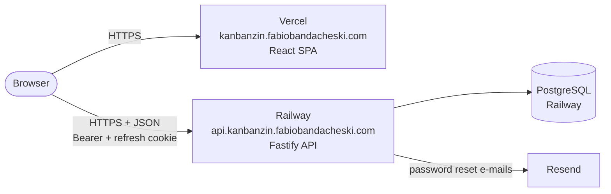
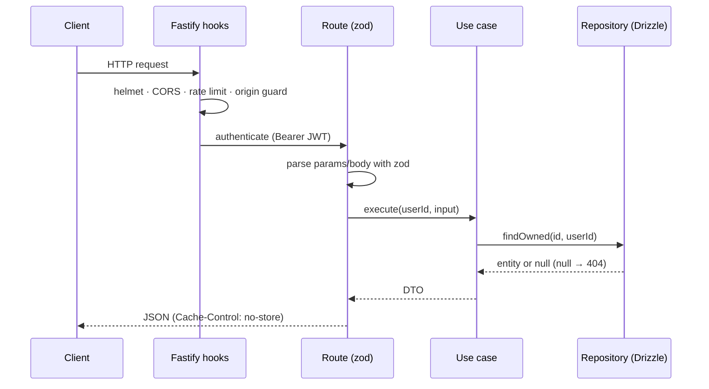
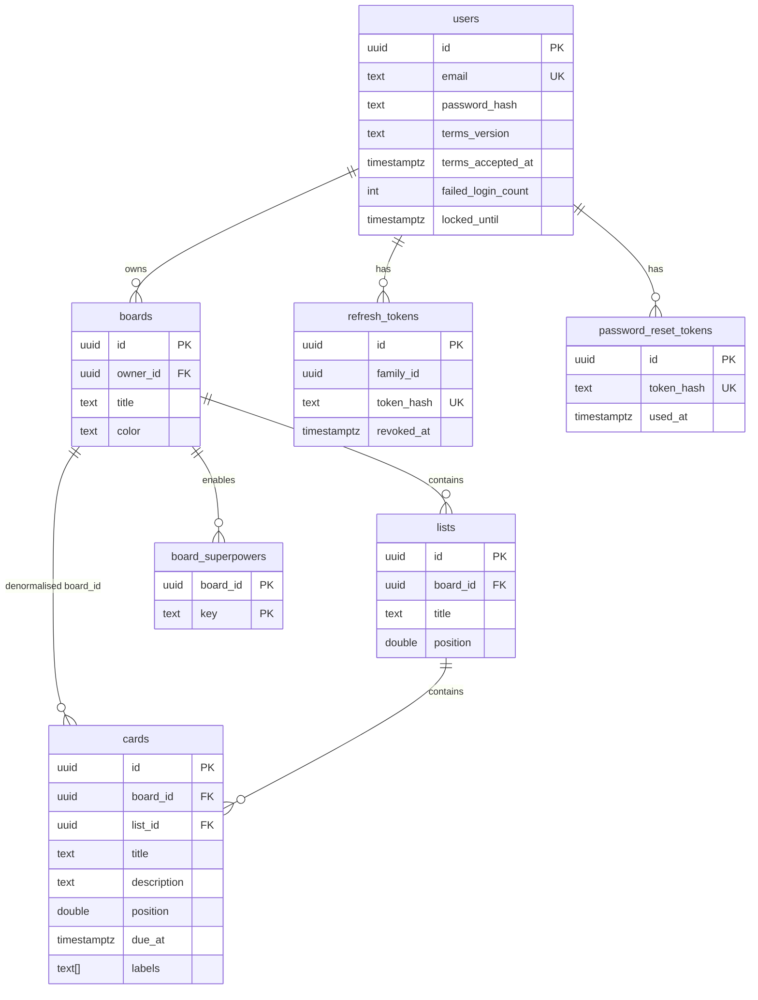

# Architecture

Kanbanzin is a monorepo with two independently deployable applications:

| App        | Path       | Runtime                               | Deployed to |
| ---------- | ---------- | ------------------------------------- | ----------- |
| HTTP API   | `apps/api` | Node.js 22+, Fastify 5, Drizzle ORM   | Railway     |
| Web client | `apps/web` | React 19 SPA built with Vite          | Vercel      |

They share no code at build time. The contract between them is the HTTP API documented in
[api.md](api.md). Keeping them independent means each one can be built, tested and deployed with
nothing but its own `package.json` (see [ADR-0001](adr/0001-independent-apps-monorepo.md)).



## Backend (`apps/api`)

The API follows **Domain-Driven Design** with a **hexagonal (ports and adapters)** layout. Code is
grouped by bounded context (module) first, then by layer.

```
src/
├─ app.ts                  Fastify wiring: security plugins, hooks, routes
├─ container.ts            Composition root: binds ports to adapters
├─ main.ts / migrate.ts    Process entry points
├─ config/env.ts           Validated configuration (zod)
├─ shared/                 Shared kernel: AppError hierarchy, Clock, Logger ports
├─ infrastructure/database Drizzle schema + driver-agnostic Database type
├─ interface/http          HTTP adapters: routes, auth guard, error mapping
└─ modules/
   ├─ identity/            Accounts, sessions, password reset
   │  ├─ domain/           Pure rules: email, password policy, user
   │  ├─ application/      Use cases + ports (repositories, hasher, mailer…)
   │  └─ infrastructure/   Drizzle repos, argon2, JWT, Resend/console mailers
   ├─ boards/              Boards, lists, cards
   │  ├─ domain/           Colors, ordering (fractional positions), limits, entities
   │  ├─ application/      Use cases, presenters, ports
   │  └─ infrastructure/   Drizzle repositories
   ├─ superpowers/         Per-board feature toggles (plugin registry)
   └─ privacy/             LGPD data export
```

### Layer rules

1. **Domain** has no I/O and no framework imports. It throws `AppError` subclasses.
2. **Application** orchestrates use cases (one class per use case) against **ports** (interfaces).
   It never imports Drizzle, Fastify or any SDK.
3. **Infrastructure** implements ports (Drizzle repositories, argon2, `jose`, Resend).
4. **Interface (HTTP)** parses and validates input with zod, calls a use case and maps the result
   or `AppError` to a response. It contains no business rules.
5. Only `container.ts` knows concrete classes. Swapping Resend for another provider or Drizzle for
   another persistence layer changes one file.

### Request lifecycle



Authorization is **ownership scoped at the query level**: repositories only return rows joined to
`boards.owner_id = :userId`. A resource that belongs to someone else is indistinguishable from a
missing one (always `404`), which prevents both horizontal privilege escalation and ID probing.

### Data model



Notes:

- Every foreign key to `users`/`boards` is `ON DELETE CASCADE`, so deleting an account (LGPD
  erasure) removes everything it owns in one statement.
- `cards.board_id` is denormalised so that loading a whole board is two indexed queries
  (`lists` and `cards` by `board_id`) and ownership checks need a single join.
- Secrets (refresh and reset tokens) are stored only as SHA-256 digests.

### Ordering with fractional positions

Lists and cards carry a `double precision position`. Inserting between two neighbours stores the
midpoint, so **moving an item is one `UPDATE` of one row**, regardless of list size. When the gap
between neighbours collapses below `1e-6`, the siblings are reindexed (`1024, 2048, …`) in a single
statement. See [ADR-0003](adr/0003-fractional-ordering.md).

## Frontend (`apps/web`)

```
src/
├─ main.tsx, App.tsx       Bootstrap, router, lazy routes, query client
├─ api/                    fetch wrapper (token in memory, single-flight refresh), endpoints, types
├─ i18n/messages.ts        All pt-BR copy and error-code → message mapping
├─ ui/                     Modal, Field, layout primitives
├─ styles/global.css       Liquid Glass design tokens and components
└─ features/
   ├─ auth/                AuthContext + sign-in / sign-up / recovery pages
   ├─ boards/              Boards home, board page, DnD canvas, queries, pure cache helpers
   ├─ superpowers/         Front-end registry of superpower modules (badges, editors)
   ├─ account/             Profile, password, data export, account deletion
   └─ legal/               Privacy Policy and Terms of Use
```

Key decisions:

- **State**: server state lives in TanStack Query. Board mutations are **optimistic** (the cache is
  patched synchronously with pure helpers in `boardCache.ts`, rolled back by refetch on error), so
  dragging a card never waits for the network.
- **Drag and drop**: `@dnd-kit` with a draft layer. While dragging, a local draft previews the move
  across lists; on drop a single `move` request is sent with the final index.
- **Performance**: route-level code splitting keeps the drag-and-drop engine out of the initial
  bundle (~100 kB gzipped initial JS); `React.memo` on cards and columns; no web fonts or third-party
  scripts.
- **Auth**: the access token is kept only in memory; the session is restored on load from the
  HttpOnly refresh cookie. See [security.md](security.md).

## Superpowers

Per-board toggleable features. Server side, a registry defines which card fields each superpower
owns and the API enforces and filters accordingly. Client side, a registry maps each key to UI
modules. See [superpowers.md](superpowers.md).
