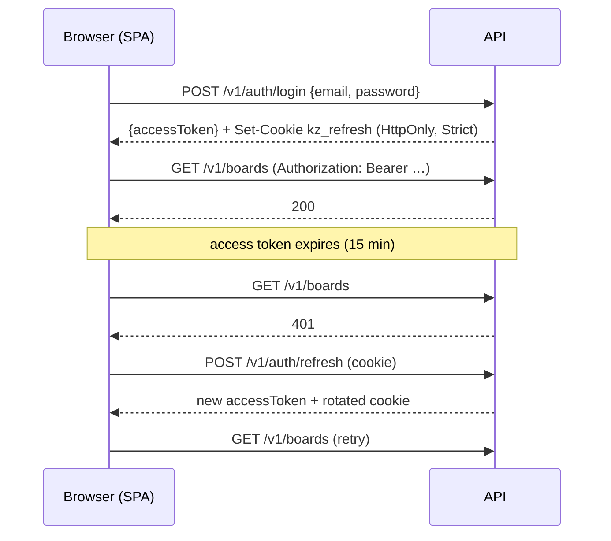

# Security

This document describes the threat model, the controls in place and how to operate them. Report
vulnerabilities privately, following [SECURITY.md](../SECURITY.md).

## Summary of controls

| Area                  | Control |
| --------------------- | ------- |
| Password storage      | Argon2id (19 MiB, 2 iterations, 1 lane — OWASP minimum), unique salt per hash |
| Password policy       | 10–128 chars, common-password and e-mail checks (NIST SP 800-63B: length over composition) |
| Brute force           | Per-IP rate limits on every auth route + account lockout (5 failures → 15 min) |
| User enumeration      | Identical responses/timing for unknown e-mail vs wrong password (dummy hash verification); `forgot` always answers `202` and sends e-mail in the background |
| Sessions              | 15-min JWT access token (HS256, `iss`/`aud` checked) kept **only in memory**; 30-day opaque refresh token in an HttpOnly, Secure, SameSite=Strict cookie scoped to `/v1/auth` |
| Refresh rotation      | Every refresh issues a new token and revokes the old one. Replaying a revoked token (outside a 10 s multi-tab grace window) revokes the whole token family |
| Token storage         | Refresh and reset tokens are 256-bit random values; only their SHA-256 digest is stored |
| Password reset        | Single use, 1 h expiry, previous links invalidated on new request, link carries the token in the URL **fragment** (never sent to servers or leaked via `Referer`), all sessions revoked after reset |
| CSRF                  | SameSite=Strict cookie, strict CORS allow-list, and an Origin check on every unsafe request that carries the session cookie |
| Authorization         | Ownership enforced in the query (join on `boards.owner_id`); foreign resources return `404` |
| Input validation      | zod on every route (types, lengths), domain validation for business rules, UUID-checked params, 100 KB body limit |
| SQL injection         | Drizzle parameterised queries only; no string-built SQL with user input |
| XSS                   | React escapes by default, no `dangerouslySetInnerHTML`, strict CSP (`script-src 'self'`), e-mail templates HTML-escape user data |
| Transport             | HTTPS only; HSTS with preload on API and web |
| HTTP headers          | `helmet` on the API (CSP `default-src 'none'`, `nosniff`, no `X-Powered-By`, `no-referrer`, CORP); CSP, `X-Frame-Options`, `Permissions-Policy`, COOP on the web (`apps/web/vercel.json`) |
| Caching               | `Cache-Control: no-store` on all `/v1` responses |
| Secrets               | Environment variables only, validated at boot (`JWT_SECRET` ≥ 32 chars; production requires `RESEND_API_KEY`); `.env` is git-ignored; auth headers and cookies are redacted from logs |
| Error handling        | Unexpected errors return a generic `500`; stack traces never leave the server |
| Resource limits       | Per-user caps on boards/lists/cards; bounded titles and descriptions |
| Supply chain          | Lockfiles committed, `npm ci`, `npm audit` in CI, weekly Dependabot PRs |
| Third parties         | No analytics, no web fonts or scripts from CDNs |

## Authentication flow

Why not store the access token in `localStorage`? Any XSS could read and exfiltrate it. Keeping it
in memory and restoring sessions from the HttpOnly cookie removes that exfiltration path.

## Domain requirement

The SPA and the API **must share the same registrable domain**
(`kanbanzin.fabiobandacheski.com` and `api.kanbanzin.fabiobandacheski.com`). That makes the refresh
cookie *same-site*, which is what allows `SameSite=Strict`. Running the SPA on `*.vercel.app` and
the API on `*.up.railway.app` would be cross-site and the cookie would not be sent.

## Operating guidance

- **Rotate `JWT_SECRET`**: change the variable and redeploy. All access tokens become invalid;
  clients transparently obtain new ones through the refresh cookie.
- **Force sign-out of everyone**: `UPDATE refresh_tokens SET revoked_at = now() WHERE revoked_at IS NULL;`
- **Housekeeping**: expired rows in `refresh_tokens` and `password_reset_tokens` are inert. Purge
  them periodically, e.g. `DELETE FROM refresh_tokens WHERE expires_at < now() - interval '7 days';`
- **Rate limiting behind a proxy**: the API trusts `TRUST_PROXY_HOPS` proxies (default `1`, the
  Railway edge) to read the client IP. Set it to `0` if the API is exposed directly.
- **E-mail deliverability**: configure SPF, DKIM and DMARC for the sending domain in Resend.

## Known trade-offs

- **Registration reveals existing e-mails** (`409 email_taken`). The usual mitigation (silent
  success + e-mail) needs e-mail verification, which is out of scope for v1. Registration is rate
  limited to slow enumeration down.
- **No e-mail verification and no MFA yet.** Both are good next steps (see the roadmap in
  [README](../README.md#roadmap)).
- **Rate limit state is in memory** (per API instance). With a single Railway instance this is
  exact; with horizontal scaling move it to a shared store (Redis) via the
  `@fastify/rate-limit` `redis` option.
