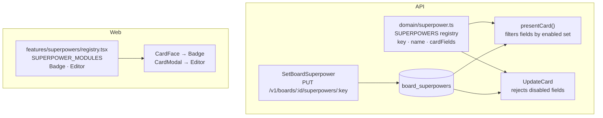

# Superpowers (plugins)

Superpowers are optional capabilities that a board owner can switch on or off **per board**, in the
board toolbar (⚡). They keep the core simple while letting the product grow: new advanced features
ship as superpowers, disabled by default, and each board opts in.

## Built-in superpowers

| Key            | Name             | Owns card field | What it does                                        |
| -------------- | ---------------- | --------------- | --------------------------------------------------- |
| `due-dates`    | Due dates        | `dueAt`         | Due date on cards; badge turns amber/red when close or late |
| `color-labels` | Color labels     | `labels`        | Up to 8 colored labels per card                     |

## Behaviour contract

- **Off by default.** A new board has no superpowers enabled.
- **Disabling is non-destructive.** Data is kept; the API simply stops returning or accepting the
  fields. Re-enabling restores everything.
- **Server enforced.** Writing a field owned by a disabled superpower returns
  `400 superpower_disabled`. Reads omit those fields entirely.
- **Independent deploys.** The web app ignores superpower keys it does not know, and the API
  ignores nothing: unknown keys return `404`. Ship the API first, then the web.

## Architecture



## Adding a superpower

Example: a `checklists` superpower.

### 1. Persistence (if it stores data)

Add columns or tables in `apps/api/src/infrastructure/database/schema.ts`, then generate and commit
the migration:

```bash
cd apps/api
npm run db:generate -- --name add_checklists
```

### 2. Register it in the domain

In `apps/api/src/modules/superpowers/domain/superpower.ts` extend `CardField` with the fields it
owns and append an entry to `SUPERPOWERS`:

```ts
{
  key: 'checklists',
  name: 'Checklists',
  description: 'Break a card into smaller steps.',
  cardFields: ['checklist'],
}
```

### 3. Expose and enforce the fields

- `modules/boards/application/presenters.ts`: add the field to `CardDto` and to `presentCard`
  behind `fields.has('checklist')`.
- `modules/boards/application/card-use-cases.ts`: validate the new input in `UpdateCard`, guarded by
  `requireSuperpower(allowed.has('checklist'), 'checklists')`.
- `modules/boards/application/ports.ts` and the Drizzle repository: persist the field.

Superpowers that need their own endpoints (not just card fields) should live in their own
`modules/<name>` folder following the same domain/application/infrastructure layout, and still use
`activeCardFields`/`enabledKeys` to check they are enabled for the board.

### 4. Add the UI module

In `apps/web/src/features/superpowers/registry.tsx` create the components and register them:

```tsx
export const SUPERPOWER_MODULES = {
  // …
  checklists: { key: 'checklists', Badge: ChecklistBadge, Editor: ChecklistEditor },
};
```

Add the pt-BR title/description to `m.superpowers` in `apps/web/src/i18n/messages.ts` and the type
for the new card field to `apps/web/src/api/types.ts`.

### 5. Test it

- Unit: registry/field activation in `apps/api/tests/unit/domain.test.ts`.
- Integration: extend the `superpowers` block of `apps/api/tests/integration/boards.test.ts`
  (rejected while disabled, accepted when enabled, data preserved after toggling).
- Web: add a test beside the module (see `registry.test.tsx`).

## Future directions

The registry is intentionally static (compiled in) to keep deployments atomic and type-safe. If
third-party plugins ever become a requirement, the same `Superpower` contract can be loaded
dynamically; per-board enablement and field gating would not change.
